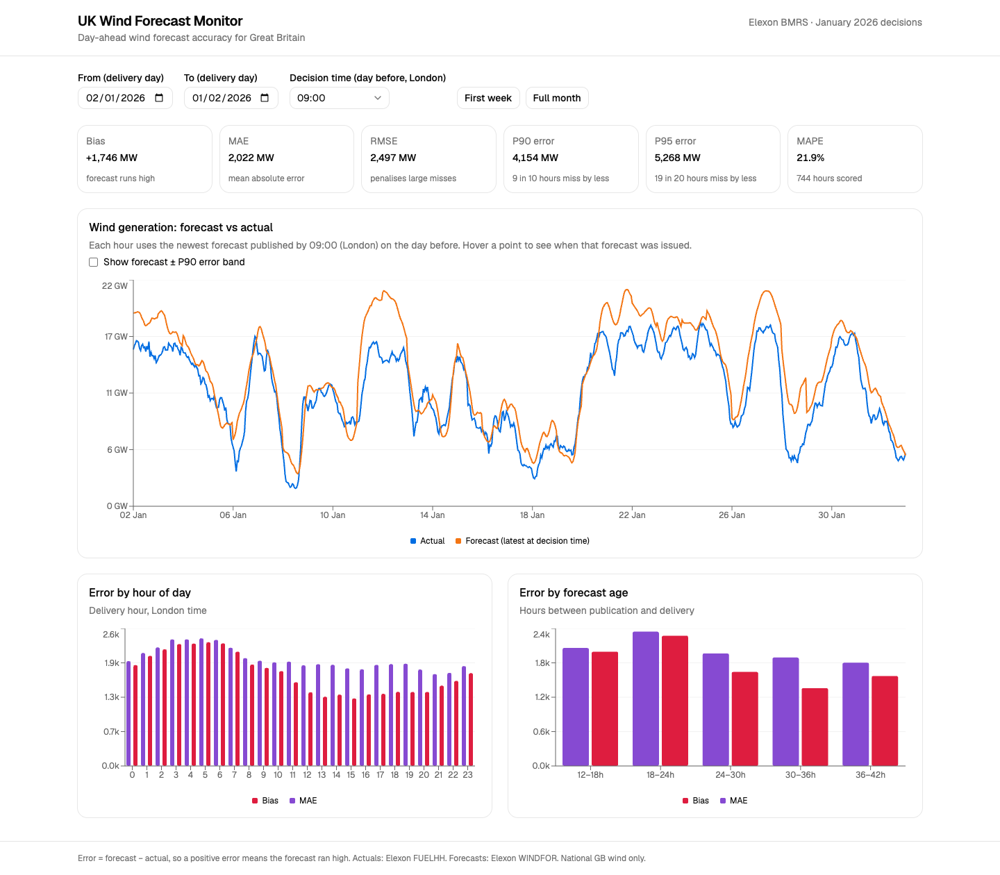
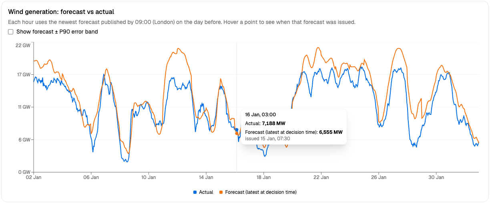

# UK Wind Forecast Monitor

A small web app for a day-ahead power buyer. For GB wind generation it shows which forecast was available when the buying decision had to be made, and how far off those forecasts turn out to be. Data comes from Elexon (actuals from `FUELHH`, forecasts from `WINDFOR`) for decisions made in January 2026.

| | |
|---|---|
| App | https://uk-wind-forecast-monitor-three.vercel.app |
| API | https://uk-wind-forecast-api-yigr.onrender.com (interactive docs at `/docs`) |
| Video | _TODO: YouTube link_ |

The API runs on Render's free tier and sleeps when idle, so the first request can take up to a minute.



Hovering a point shows the forecast used and when it was issued:



## How it works

For each target hour, the buyer decides the day before at a cutoff time (09:00 London by default, adjustable in the UI). The app uses the latest forecast published at or before that cutoff. Taking the newest forecast overall would use information the buyer didn't have yet, which flatters the forecasts. The logic is in `backend/app/selection.py`.

The brief leaves some things open, so I made these choices:

- Decision time is 09:00 London on the day before. It's a control, not a hardcoded value.
- `WINDFOR` is hourly and `FUELHH` is half-hourly. I compare at the top of each hour using the HH:00 actual. Averaging in the HH:30 value moves MAE by only about 15 MW.
- Elexon data is UTC. The cutoff and hour-of-day use `Europe/London`, so daylight saving is handled (there are tests for it).
- The window is delivery days 2 Jan to 1 Feb 2026, which covers decisions made on 1 to 31 Jan.
- Error is forecast minus actual, so positive means the forecast ran high.
- The app reads a saved snapshot in `backend/data` instead of calling Elexon live, so it doesn't depend on their uptime.

## Metrics

Bias is the average signed error. MAE is the average size of a miss. RMSE is similar but weights big misses more. MAPE is the miss as a percentage of the actual. P90 and P95 are the error that 90% and 95% of hours stay under, which is what you'd use to size a buffer.

## What the data shows

Over 2 Jan to 1 Feb with the 09:00 cutoff: bias +1,746 MW, MAE 2,022 MW, RMSE 2,497 MW, MAPE 21.9%, P90 4,154 MW. The forecast runs high in every week of the month, so a buyer trusting it blindly would tend to under-buy backup power.

I can't fully explain the bias. It isn't a timestamp shift (I tried moving the actuals by up to 3 hours). Part of it may be a definitions gap, for example if `FUELHH` only counts metered wind, but I haven't checked. Error by forecast age also isn't monotonic and I don't know why. And it's only one month of data.

## Run it

Start the app:

```bash
docker compose up --build   # app on http://localhost:8080, API docs on :8000/docs
```

Tests (run `pip install -r requirements-dev.txt` in `backend` and `npm install` in `frontend` first; CI runs these plus a Docker smoke test):

```bash
cd backend  && ruff check . && pytest
cd frontend && npm run lint && npm test && npm run build
```

To refresh the data snapshot: `cd backend && python scripts/fetch_data.py`.

API endpoints: `/health`, `/api/meta`, `/api/series`, `/api/metrics` (see `/docs`).

## AI use

I used Claude Code (Anthropic) throughout, and the commits carry a `Co-Authored-By` trailer. Here is how the work split:

- **Explore:** it probed the live Elexon API and found the hourly versus half-hourly mismatch and the stale forecast rows.
- **Understand:** it explained the domain (day-ahead buying, why a forecast must be cut off at decision time) and we settled the metric definitions.
- **Plan:** it drafted a step-by-step plan with the reasoning for each step, and I approved the plan and each step as we went.
- **Code:** it wrote the backend, frontend, Docker, CI and deploy config, with the selection logic written test first.
- **Test:** unit and API tests, lint, CI, a manual check of the running app in a browser, and throwaway scripts for sanity checks such as the timestamp-shift test.
